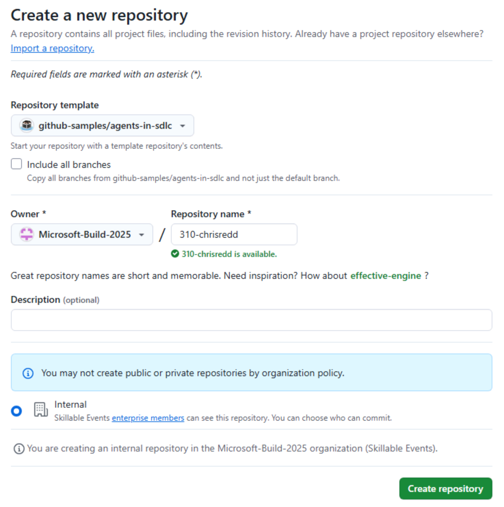

Antes de começar os exercícios do agente na nuvem do Copilot, prepare tudo. Você vai criar sua própria cópia do repositório Tailspin Toys e iniciar um [codespace][codespaces] para editar arquivos de instruções e revisar o trabalho produzido pelo agente na nuvem.

## Configure o repositório do laboratório

Para criar uma cópia do repositório para o código que você desenvolverá, crie uma instância a partir do [template][template-repository]. A nova instância conterá todos os arquivos necessários para o laboratório, e você a usará ao longo dos exercícios.

1. Em uma nova janela do navegador, acesse o [template da Tailspin Toys][tailspin-template].
2. Crie sua própria cópia do repositório selecionando o botão **Use this template** na página do repositório do laboratório. Em seguida, selecione **Create a new repository**.

    

3. Se você estiver participando de um workshop em um evento conduzido pelo GitHub ou pela Microsoft, siga as instruções dos mentores. Caso contrário, crie o novo repositório em uma organização à qual você tenha acesso com o GitHub Copilot.

    

4. Anote o caminho do repositório criado (**organization-or-user-name/repository-name**), pois você vai usá-lo mais adiante no laboratório.

## Crie um codespace

Em seguida, você usará um codespace para concluir os exercícios do laboratório.

[GitHub Codespaces][codespaces] são ambientes de desenvolvimento na nuvem que permitem escrever, executar e depurar código diretamente no navegador. Eles oferecem um IDE completo com suporte a várias linguagens de programação, extensões e ferramentas.

1. Acesse o repositório que você acabou de criar.
2. Selecione o botão verde **Code**.

    

3. Selecione a guia **Codespaces** e selecione o botão **+** para criar um novo Codespace.

    

A criação do codespace levará alguns minutos, embora ainda seja muito mais rápida do que instalar todos os serviços manualmente. Enquanto isso, você pode explorar outros recursos do GitHub Copilot, que veremos a seguir.

> [!CAUTION]
> Você voltará ao codespace em um exercício futuro. Por enquanto, deixe-o aberto em uma guia do navegador.

> [!NOTE]
> Este workshop foi criado para ser executado em um codespace ou em um [contêiner de desenvolvimento][dev-containers] local. Ambos garantem que o ambiente tenha todos os pré-requisitos instalados para uma experiência tranquila. Se preferir executá-lo localmente, abra o repositório clonado no VS Code e selecione **Reopen in Container** quando solicitado — o VS Code compilará o mesmo contêiner de desenvolvimento usado pelo codespace.

[codespaces]: https://github.com/features/codespaces
[dev-containers]: https://code.visualstudio.com/docs/devcontainers/containers

## Resumo

Parabéns, você criou uma cópia do repositório do laboratório! Você também iniciou a criação do seu codespace, que usará enquanto trabalha com o agente na nuvem do Copilot.

## Próxima etapa

Vamos adicionar instruções personalizadas que o agente na nuvem seguirá. Continue para [Exercício 1 - Instruções personalizadas][next-lesson].

## Recursos

- [Visão geral do GitHub Codespaces][codespaces]
- [Como criar um repositório a partir de um template][template-repository]
- [Primeiros passos com o Codespaces][codespaces-quickstart]

[tailspin-template]: https://github.com/github-samples/tailspin-toys
[template-repository]: https://docs.github.com/repositories/creating-and-managing-repositories/creating-a-template-repository
[codespaces-quickstart]: https://docs.github.com/codespaces/getting-started/quickstart
[next-lesson]: ../1-custom-instructions/
